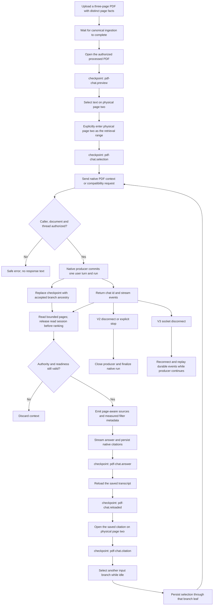

# alphaXiv PDF chat

Status: manual native PDF-chat live acceptance passed in the local worktree;
full automated scenario coverage remains `planned`. The automated runner has
not been executed live. `covered` describes scenario/checkpoint coverage,
not a live `PASS`; see the [verification contract](../verification.md).

The native UI scenario `workflow.pdf-chat-selection-stream-reload` uploads a
real three-page PDF, selects a neutral word on its second page, explicitly
restricts retrieval to page two, submits through the composer,
and checks the answer, saved citations and citation navigation. It requires
genuine authentication, completed ingestion and a working model provider.
Separate live probes passed the v2 happy path, v3 submission and canonical
branch persistence, and v3 completed-run WebSocket snapshot/reconnect after a
targeted authentication fix. A later two-turn live probe also passed active v3
reconnect/stop, v2 disconnect cleanup, stale-stop isolation, and branch editing,
switching and follow-up context isolation. Two authenticated hosted v2 UI turns
were verified on 2026-10-14; see the hosted checkpoint below. The automated
browser scenario remains open. Hosted v3 completion and cancellation were
subsequently observed; see the later v3 checkpoint below.
See the [compatibility contract](../alphaxiv-compatibility.md).

Acceptance requires a real processed PDF and a working NOUS model provider.
The native scenario must observe the actual request's zero-based range
`[1, 1]`, document-only scope and exact PDF identity. Its answer must contain
the selected page's fact and exclude facts from both unselected pages.
An answer assertion, page citation and reloaded transcript are separate checks;
a rendered range control alone cannot establish retrieval scope.
The scenario also checks the exact quoted question in the request and history,
keeping the answer token absent from the whole composed question.

This scenario exercises `/api/v1/agent/stream` through the NOUS UI. It does
not establish compatibility v2/v3 runtime behavior or alphaXiv server parity.
The feature stays `planned` while those broader mapped criteria lack registered
scenario coverage. The later manual API probes are separate evidence. Inspect
all five scenario checkpoints before reporting an automated native live pass.

## Recorded manual native acceptance

The manual computer-use run used a genuinely processed three-page PDF and an
unmocked native model stream. Double-clicking rendered PDF text on physical
page 2 populated the range; Ask about PDF and the composer submitted the
request without injecting PDF or chat stores. The recorded request had
`document_only=true`, `selection_page_range=[1,1]` and exactly that PDF attachment.
The strict [QA oracles](../../../tests/e2e/qa/pdf-chat.mjs) passed on the saved
request, native SSE and history: only the selected fact was answered, the source
was physical page 2, and exactly one user and one assistant were persisted.
After reload, the answer and citation remained; opening that citation placed
physical page 2 at the viewer's top. Selection, answer, reload and citation
screenshots were inspected separately.

The local investigation bundle
`alphaxiv-reverse-engineering-2026-10-13-01a1377f` preserves
`live-native-{request.json,stream.sse,history.json,assertions.json,citation-geometry.json}`
and the selection/answer/reload/citation screenshots. Its run is
`6160abe7-e3ef-42d2-a70a-a3e204f61f44`, thread
`4733d7be-b741-4228-a990-21ec28dd888f`, document
`a270b4c5-333a-4b22-84df-6ab31ccafa9e`; saved message timestamps are
serialized by the history API as 2026-10-14 07:24:56–07:25:00 UTC. The separate
database proof records run completion at 2026-10-14 03:25:00 UTC; these
source-specific timestamp representations are preserved without treating them
as a consistent wall-clock chronology. The source is the uncommitted
`codex/alphaxiv-pdf-api` worktree at base HEAD
`85cf136132ab763b48ef31ce8a086a1fe8ac084d`, not a deployed or CI-tested commit.

This manual pass does not execute the registered automated scenario, nor the
v2/v3 reconnect/stop or branch paths shown in the diagram. At that checkpoint,
the alphaXiv browser still showed Join us. The later authenticated hosted v2
checkpoint below supersedes that authentication blocker.

## Compatibility probe checkpoint

The local bundle's `live-db-evidence.json` independently verifies the native
run: one completed run, two canonical messages, exact actor/organization and
workspace ancestry, one attachment, only physical-page-2 citations and no tools.
That UI thread is linear; its null message parents do not test branch switching.

`compat-live-smoke-initial-results.json` preserves a separate two-model-turn
probe, including its overall failure. V2 SSE passed HTTP 200, run-start/run-end
ordering, selected-page answer and citation projection, saved history and
canonical root-user/assistant parent linkage. V3 POST returned HTTP 200 and its
producer completed with the same bounded answer, two linked canonical messages,
bound PDF, selected assistant leaf and dense durable ledger ending in completion.

The first v3 WebSocket failed on a naive-UTC versus timezone-aware expiry
comparison. The targeted native-auth regression reproduced that failure; the
minimal UTC-normalization fix passes 28 focused tests and independent review.
The separate `compat-replay-after-fix.json` records the successful live replay
after API restart, preserving the original failed record. Genuine Supabase
authentication replayed completed run `15fa8af4-540e-4cb4-ad11-32dea95c6994`
without another model turn. Its 21 presentation events had dense positions,
`run_start` first, one completed `run_end` last, and no error; reconnect returned
an identical snapshot. History returned HTTP 200 with matching canonical IDs,
selected-page answer and physical-page-2 citation. The database retained one
completed run, two messages and its dense 29-record canonical ledger.

This checkpoint establishes completed-run snapshot/reconnect only. The later
lifecycle checkpoint below supplies active-run and branch evidence; upstream
parity remains unverified and full feature coverage stays `planned`.
The original `live-cleanup.json` confirms all 27 owned processes stopped, all three
supervisors exited successfully and assigned local ports closed; fixtures and
evidence were preserved. `live-status.json` retains the Node 24.21.0 and
task-private development-cache adapter configuration used by this local run.

## Active lifecycle and branch checkpoint

At 2026-10-14 03:54:13–03:54:27 UTC,
`lifecycle-2026-10-14/lifecycle-probe-results.json` recorded
102 successful assertions across exactly two new submission attempts and two
accepted model turns. The backend-only probe reused the processed PDF and chat
above, genuine Supabase authentication, an unmocked model provider, and isolated
PostgreSQL/Redis. It made no product source changes. `lifecycle_probe.py` in the
same bundle subdirectory preserves the reviewed probe and its two-attempt cap.

- V3 edited-root run `ff6c341a-ffb1-48ae-a3f1-e6bb8f0990d8` remained active
  across socket disconnect/reconnect, extended the same dense event prefix,
  and produced new output. Branch selection during that run returned 409 and
  preserved selection. Exact stop yielded one aborted wire terminal and one
  canonical cancellation with reason `user_requested`; repeated stop claimed
  no new cancellation. Idle selection switched original/edited/original paths
  with persisted selected timestamps and the expected descendant leaf.
- V2 follow-up run `7e2dfae0-1013-468e-ac22-9cc1cf00eaf7` used the original
  assistant as its canonical parent. A stale stop naming the earlier v3 run
  left this run active and producing output. Closing its response body then
  produced one canonical cancellation with reason `client_disconnected`.
- Both interrupted turns retained one nonempty, stopped canonical assistant
  under the correct user, released their leases and left no active runs.
  Original and edited messages remained intact. Real saved graph checkpoints
  independently excluded the original sibling from the edited-root input and
  the edited sibling from the original-branch follow-up input. Provider request
  bodies were not captured; checkpoint context and transcript ancestry are
  separate evidence.

This closes the listed local lifecycle and branch permutations. It does not
execute the registered automated browser scenario or establish hosted alphaXiv
behavior. First-page conversion has the separate viewer-fixture evidence;
the manual native acceptance covers the non-first range and citation reload.
Unavailable-page and revoked-access behavior retain the unit coverage listed
in the compatibility contract, without a new end-to-end live claim here.
The separate `resume-cleanup.json` confirms all 18 resumed owned processes
stopped, the coordinator exited successfully and the assigned backend ports
closed. The original runtime and cleanup receipts remain unchanged.

## Automatic page ranking checkpoint

The later `ranker-2026-10-14/` bundle records 61 successful assertions across
exactly three submission attempts and three completed model turns, using
genuine Supabase authentication and configured Azure/Cohere providers:

- Explicit `filterModel: "cohere"` without a selected range ranked a processed
  12-page PDF in approximately 415 ms. Physical page 9 had the highest score;
  accepted pages were 1, 2, 3, 5, 9 and 10. The answer cited source position 5,
  mapped to physical page 9 in both wire output and canonical history.
- A three-page PDF bypassed ranking. All three pages remained available;
  no provider call, model name or timing was invented.
- Omitting the filter with `AGENT_PAGE_FILTER=false` retained the bounded
  native excerpt path and an unpaged citation. It emitted no ranking metadata.

The first probe receipts retain harness failures: an overly narrow saved-citation
oracle and indexing legitimately omitted optional metadata. Read-only corrections
validated the existing three runs; they did not repeat model submissions or
change product source. Canonical history stores all accepted context sources,
which can exceed the sources actually cited in the answer. The global flag
remains off; these checks do not establish alphaXiv's server default.

## Selected quotation checkpoint

The `quote-2026-10-14/` bundle records one further manual native UI turn at
2026-10-14 04:18 UTC. A double-click on actual page-two PDF text showed the
passage and range in the viewer. Ask transferred them to the composer and
cleared the viewer selection. Exactly one POST sent the quote followed by
the question, `selection_page_range=[1,1]`, document-only scope and the same
processed PDF. Run `f893bd00-184f-4daa-86eb-6cada6571fc6` in thread
`21c6020c-bab6-40fc-bea1-9e80bbdee1f3` returned only the selected-page token
with a physical-page-2 citation. The quote and derived range cleared after
acceptance, while PDF scope remained in the composer.

The existing strict native QA oracles passed against captured request, SSE
and history. The saved question contained the quote exactly once; one answer
and its page citation survived reload unchanged. Opening the citation placed
page 2 within one pixel of the viewer's top. Screenshots, sanitized request and
response bodies, citation geometry, the assertion script and its result are
preserved. The initial network counter included two read-only resume requests;
the corrected receipt counts only the single exact stream POST, preserving
the original receipt without another submission.

This manual quote run selected the answer token itself, so it proves quote
transport and bounded retrieval context, not that the model needed retrieval
to learn that token. The earlier native run asked without quoting the token.
The registered scenario now selects a neutral heading word, checks exact quote
transport and keeps the answer absent from the composed question; it has not
been run live. Its request-oracle regression rejects omitted, duplicated or
changed quotes and questions.

The quote increment passes 3,048 frontend tests across 391 files, TypeScript,
the existing frontend quality ratchets and eight targeted guard mutations.
Independent source review found no additional findings. This is manual browser
evidence plus unit/mutation coverage, not execution of the registered automated
browser scenario or authenticated upstream comparison.

A later first-visit check used normal sign-out/sign-in, then opened the document
directly from the dashboard without first visiting chat. Double-clicking the
neutral heading word `Physical` on page 2 transferred `> Physical` and range
2–2 into the new composer. The document-detail action now waits for the existing
workspace bootstrap before staging its owner-bound receipt; failed setup keeps
the selection retryable. This check sent no question or model request.
`quote-2026-10-14/first-handoff-browser.json` and its selection/composer screenshots
preserve the result. Its passive network buffer evicted earlier pre-handoff
events, so that partial buffer is not an exhaustive request-count proof.
The independent database comparison retained exactly the same nine runs and
18 messages. Final first-visit validation passed 3,061 frontend tests across
391 files, TypeScript and nine further guard mutations, with no new lint errors.
The separate first-handoff cleanup receipt confirms all 25 owned processes
stopped and all four assigned ports closed; the one-use login bridge was removed.

## Authenticated hosted v2 checkpoint

On 2026-10-14, two authenticated alphaXiv UI turns exercised quoted text
(`Sequence`) and a whole-paper follow-up. Both submitted `/assistant/v2/chat`
with `protocol: 2`, `model: "pro"`, `files: []`, `thinking: null`,
`webSearch: "full"`, `selectionPageRange: null` and no `filterModel`.
The SSE records contained status phases and page-analysis progress, text
deltas, `context_window_usage` and `persisted_messages`, then completed at
EOF. Neither stream contained `run_start`, `run_end` or `paper_filter_debug`.
Citation clicks opened physical pages 3 and 19, and both answers remained
after reload. The whole-paper SSE capture has an unresolved punctuation-decoding
discrepancy; this is not a byte-identical text assertion or a proven product defect.

The sanitized captures and `HOSTED-COMPARISON.md` are in the local evidence
directory
`/Users/goodwiinz/.codex/visualizations/2026/10/13/01a1377f-71aa-7dd3-9afe-c4eefbecc3d6/alphaxiv-hosted-2026-10-14`.
This is manual hosted v2 evidence, not a registered workflow-test pass or
NOUS deployment/parity claim. It demonstrated no required adapter code fix:
the shipped SSE consumer tolerates NOUS lifecycle events and refetches history
when `persisted_messages` is absent. NOUS still omits hosted progress detail
and measured current-context usage.

The hosted quote flow did not send a page range. NOUS's hard range restriction
therefore remains an explicit adaptation, not a verified hosted behavior.
Page-analysis labels without diagnostics do not establish accepted pages,
ranking identities, provider choice or general filter defaults. Hosted v3/live,
branch-selection mutations, validation and failure behavior remain unverified.

## Authenticated hosted v3 and filtering checkpoint

A later 2026-10-14 checkpoint enabled the shipped `live-assistant-stream` flag
through its feature link. The current loaded client assets matched the retained
source hashes. A complete hosted v3 run returned chat/run IDs and an initial
`{runId,seq,events}` snapshot, followed by dense deltas through a completed
`run_end`. Another run was cancelled once through the UI: stop returned HTTP
204 with an empty body and the terminal event used `kind: "aborted"`.
The temporary flag was then disabled through its individual switch.

NOUS now includes snapshot `seq`, retains nullable `run_start.thinking` in its
durable presentation record, and returns an empty 204 from the stop route.
Existing native authorization, cancellation and replay ownership are unchanged.
Quote-only UI intent now keeps source-page provenance separate from an explicit
retrieval range. Whole-PDF questions request the existing Cohere ranker per turn;
manual ranges retain precedence and do not request automatic ranking.

The hosted UI's filter controls are administrator-gated. Its ordinary stream
reported analysis of all 19 pages but supplied no accepted-page diagnostics.
The native ranker choice is therefore a functional adaptation, not verified
equivalence to the hosted scoring algorithm or global defaults. A separate
reload during generation retained the completed answer, but that segment had
capture eviction and does not prove uninterrupted active replay. A later
subscription returned a null snapshot. No hosted retention TTL is inferred.

Sanitized observations and validation receipts are retained in the local
`alphaxiv-v3-filter-2026-10-14` evidence directory beside the hosted v2 bundle.
The prior checkpoints remain historical records of the earlier range behavior.
This checkpoint does not mark the registered browser workflow as executed.

## API defaults and independent page-scope checkpoint

The compatibility boundary now accepts the observed `model: "pro"` preset,
resolving it to the configured NOUS model while retaining `pro` in the public
presentation. Omitted or null `filterModel` requests the native Cohere page
ranker unless an explicit range is present. A range overrides even an explicit
filter choice. Unknown presets and unsupported filters still fail validation;
native global defaults and authorization remain unchanged. The focused v2/v3,
page-context and reasoning matrix passed 153 tests, including actual native
request preparation and RAG-node dispatch with controlled providers.

Two further manual native UI turns used real processed PDFs and providers:

- Whole-PDF run `ac8f7f5d-f238-4c8e-878d-6c50fb6969a6` quoted only the neutral
  word `Physical` from page 2. The question's answer existed on physical page 9.
  The request contained `page_filter_model: "cohere"` and no range. Ranking
  accepted pages 2, 3, 5, 6, 9 and 10 of 12; page 9 had the highest score.
  The measured call took approximately 305 ms. The answer cited Doc 5,
  correctly mapped to physical page 9 in stream context and saved history.
- Range run `e5c59ad8-3224-413f-8600-99656b253ff2` used the same neutral quote
  with separately entered page controls 2–2. Its request contained `[1,1]`
  and no automatic-filter model. Only physical page 2 reached model context;
  the answer contained its token and excluded the other two page tokens.
  Filter metadata reported no provider/model/timing for this short circuit.

Answers and page citations survived reload, and citation controls opened the
correct rendered pages. The two canonical verification receipts passed 33 and
36 checks respectively, with exactly two new runs/four new messages and zero
active runs. The range submission-through-terminal capture is untruncated;
the later reload capture reported eviction and is not an exhaustive network
record. Canonical history and counters independently establish persistence.
The native PDF composer binding was still transient at this checkpoint.

Evidence and cleanup receipts are in `alphaxiv-native-defaults-2026-10-14`,
beside `alphaxiv-api-defaults-2026-10-14`. These are manual browser and provider
checks, not a live execution of the registered automated scenario.

## Hosted reload and terminal replay checkpoint

A single hosted v3 submission produced run
`01a13c1c-007e-7c5a-88a9-95769e1b366d`. The passive capture retained a dense
prefix of 1,047 events, followed by an ordinary page reload during output.
Reopening the same recent chat subscribed again and returned a completed
1,356-event snapshot for that same run. Every retained prefix event matched
the corresponding snapshot event; its concatenated text matched the one
persisted answer under the one exact submitted question. Fourteen offline
assertions passed, with one submission POST and no stop request in the complete
bounded capture. The individual live-stream flag was restored to off.

This proves continuation across page reload and completed-run replay. The
producer finished before resubscription, so it does not establish delivery of
new active deltas after reconnect. The HTTP 200 submission response was observed,
but its JSON body was evicted on reload. The paper URL's `chatId` did not select
the conversation automatically; the recent-chat control was required. The
hosted UI rendered the answer once but displayed the earlier aborted question
above it, despite correct new-question persistence. That display behavior is
recorded rather than copied into NOUS.

The sanitized capture, persisted history, verification script, receipt and
screenshots are in `alphaxiv-reconnect-defaults-2026-10-14`. No private ranking
threshold, provider default, reconnect backoff execution or retention TTL is
inferred from this bounded observation.

## Native durable PDF binding and alternatives checkpoint

Native thread and message reads now return the bound PDF, canonical selected
head and sibling user IDs. They select ancestry before pagination and require
the same head on continuation pages. Fresh PDF authorization and a locked read
snapshot prevent stale access or mixed branch pages. The native store hydrates
this contract on reload; edits and retries use the original canonical parent,
and alternative selection refreshes the selected path without generating again.

A manual two-turn browser probe used thread
`7007af32-6dfd-468a-8e1c-1176877596d6` and the retained three-page PDF. Both
requests supplied its document binding, an explicit null root parent, automatic
page filtering and no supersession ID. The original asked about physical page 2;
editing it asked about page 3 and preserved the original question and answer.
The UI displayed alternatives 1 of 2 and 2 of 2, restored each selected path,
and retained the edited path and authorized PDF scope after reload. Its page-3
citation opened the rendered physical page 3. No third model request was made.

Answer quality is reported separately: the original model output was
`NOUSELECTEDLIVE13OCT2026`, omitting the `S` from the source's
`NOUSSELECTEDLIVE13OCT2026`, despite the correct page-2 citation and source text.
The edited answer exactly matched `NOUSTHIRDLIVE13OCT2026`. The original stream,
database and reload retained the same output, so its exact-token assertion fails;
this is not recorded as an all-green model acceptance. The combined browser
capture reports eviction and is not an exhaustive network trace. Both complete
SSE bodies and independent canonical snapshots are retained.

The final canonical state contained exactly 14 runs, 28 messages and zero active
runs across the retained fixture, including the two new runs and four new rows
in this thread. Thirty original-turn and 43 final-state structural assertions
passed. The browser check also exposed a hover action row displacing the
alternative buttons. Moving the alternatives before that row stabilized their
position; 39 focused component tests and a second pointer-only browser check
passed. That second capture was untruncated and contained two selection POSTs
and no generation POST. Both original and edited paths remained available.

The backend focused matrix passed 256 tests, followed by 19 tests in the expanded
HTTP/service file. Two PostgreSQL checks covered read/selection serialization
and migration roundtrip; removing the read lock or head pin failed the targeted
tests as intended. The frontend full suite passed 3,106 tests in 395 files, and
nine targeted mutations were killed and restored. TypeScript, pinned backend
style/type checks and frontend quality comparators passed. These counts overlap
and must not be summed. The combined wrapper remains non-clearing because its
generated-type gate compares the unstaged regenerated contract to the index;
generation and OpenAPI freshness passed. Its separate PostgreSQL migration
probes were skipped, distinct from the two directly executed PostgreSQL checks.

Receipts, snapshots, complete streams, screenshots and bounded capture are in
`alphaxiv-native-branches-2026-10-14`. This remains manual local acceptance,
not registered automated workflow execution, CI, deployment or proof of the
hosted service's private model and ranking policy.

## Publication preparation checkpoint

On 2026-10-14, OpenAPI and its TypeScript consumer were regenerated together and
staged for publication. `pnpm --dir frontend check:api-types` then passed with
no generated diff. This clears the index-comparison limitation recorded above;
neither the generator nor the gate was weakened. The earlier validation and
model-quality observations remain unchanged.
