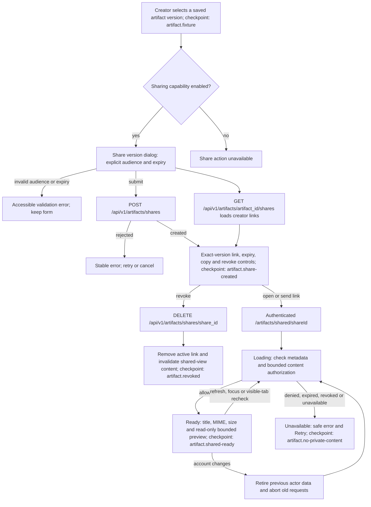

# Flow: authenticated artifact version sharing

States: loading → ready | unavailable; creator revocation → revoked.
The [feature map](../feature-map.yaml) maps this flow to the registered
`workflow.artifact-version-sharing` QA scenario. `covered` records scenario
coverage, not a live pass. Live execution and its screenshot checkpoints are
**NOT RUN**; the scenario requires authentication, authorized fixture writes,
a configured model, a browser and enabled artifact/sharing capabilities.
Local behavioral evidence
is recorded in the [October 11 verification report](../../testing/artifact-workspace-completion-2026-10-11.md).
That record includes four passing Chromium proofs using the real sharing UI,
Query hooks and bounded PDF preview under the parent CSP, with explicit local
auth/context/HTTP fixtures. It does not establish a live signed-in backend journey.

In the generated artifact panel, **Share version** is available when the server
sharing capability is exactly true. The dialog targets the selected saved
version, accepts 1–100 existing user UUIDs, and shows a local-time expiry bounded
to seven days. Submission converts that expiry to a timezone-aware timestamp.
Only explicit active users in the same organization form the audience; the
creator is not automatically a recipient. A recipient does not need project
membership, and the link grants access only to the pinned version.

The creator's active-link list is scoped to the selected version. Copy produces
an absolute link to `/artifacts/shared/{shareId}`. Cancellation, account changes,
and version/context changes retire pending dialog requests; late responses
cannot populate a reopened dialog or another actor's cache. Focus starts on the
audience field and returns to the Share version button after closing.

The dashboard layout requires authentication for the shared route. Its metadata
and bytes share one actor/organization/share-scoped TanStack Query entry. During
an access recheck the preview unmounts, releasing prepared text, image URLs,
sandbox documents and PDF workers. A denied recheck replaces cached content
with the unavailable state. The page offers no source, provenance, version
editing or project access controls. Downloads also use the authenticated share
content endpoint.

Each metadata/content request rechecks the audience, expiry, revocation and live
creator/ancestor authority. Content reads recheck again after storage I/O.
Creation and revocation require browser authority and current owner rights.
Creation requires enabled write flags; owner revocation and committed share
reads remain available when those flags are disabled. These
rules are implemented by the [sharing service](../../../backend/src/services/artifacts/sharing.py)
and [artifact transport](../../../backend/src/api/artifacts.py); general ownership
and verification rules remain in the [frontend](../frontend.md),
[API](../api-contracts.md) and [testing](../testing.md) contracts.
