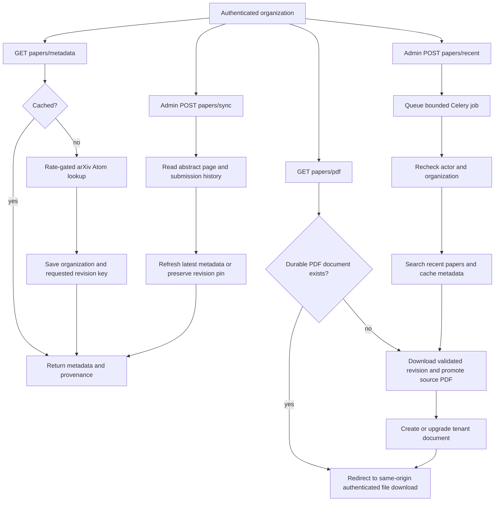

# arXiv paper lifecycle

Backend contracts implemented from confirmed alphaXiv workflows. Browser QA is
planned; service and route tests cover these contracts locally.

`GET /api/v1/arxiv/papers/metadata?paper_id=...` caches until explicit sync.
`POST /api/v1/arxiv/papers/sync` accepts `{ "paper_id": "..." }`. `withdrawn`
is null when unchecked or withdrawal wording is ambiguous; `latest_id` and
`latest_withdrawn` describe the latest
abstract page even when the request pins an earlier revision. A failed parse
does not replace cached metadata. New revisions refresh dates/categories from
the corresponding Atom entry.

`POST /api/v1/arxiv/papers/recent` accepts categories (1–10), max_results
(1–50, default 20) and days (1–7, default 1). It returns 202 only after Celery
accepts publication; a broker failure returns 503. Workers recheck the active
administrator and organization before each paper. Celery's task result reports
imported/failed counts. No polling endpoint or automatic cadence is added.

PDFs are stored using existing compensated arXiv persistence and delivered by
`/api/v1/files/{document_id}/download`. Abstract-only rows are upgraded in place.
This operation does not claim to extract or index the PDF's full text.
Later full-text ingestion enriches the same document and rebuilds its search
vector without re-uploading the PDF. Artifact upgrades preserve existing full
text. Cache hits and stored PDF reads do not consume the shared research quota;
upstream misses are admitted once per request. Recent imports insert missing
metadata without overwriting explicit sync results.

Deployment requires migration `ax01_arxiv_paper_cache`, the declared HTML parser
dependency, and restarted API/Celery workers. The table is backend-only with RLS
enabled and browser-role access revoked. These are NOUS implementation choices;
alphaXiv's production upstream transport and refresh cadence remain unknown.
